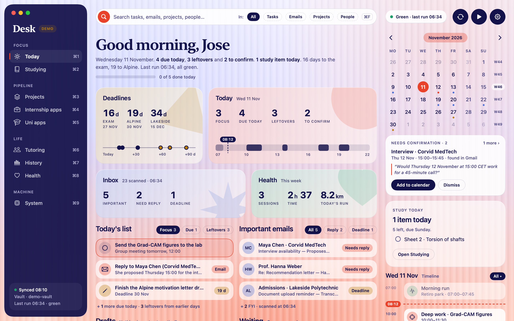
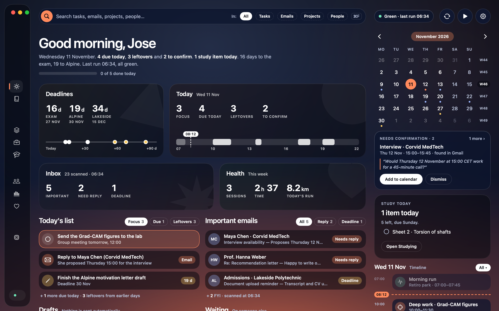

# Desk for Mac

My personal life manager: a native macOS app that answers "what now?" in one glance. Eight tabs: **Today, Studying, Projects, Internship apps, Uni apps, Tutoring, Health, System.**




## How it works
Cloud agents read my inbox, calendar and Strava every night and write a brief into a private Obsidian vault, which is a git repo. Desk reads those files and my Mac calendar. This repo ships with `demo-vault/`, fully invented data, so the app runs without any of my real information.

## Design choices
These are mine; they are written down in [SPEC.md](SPEC.md) and [DESIGN.md](DESIGN.md).

- **A real native app, not a Claude interface.** SwiftUI, one Swift package, no third-party code.
- **Heavy and physical.** Big type, solid colour blocks, a graphite sidebar over a warm canvas. I took the structure from dashboards I like and swapped their pastels for a darker, earthier palette. No glass, no gradients.
- **Colour marks the category, words carry the meaning.** Every status has a label, never colour alone.
- **Agents read and draft; only I act.** Nothing is sent automatically. A proposed calendar event or a ticked task happens when I click, never before.
- **No server, no credentials.** The app holds no tokens. Its only network use is `git` on the vault and opening links.
- **Untrusted text stays text.** Anything that came from email is drawn as plain text: no Markdown, no links.
- **One writer per file.** The agents own their files, I own mine, and the app writes only mine.
- **WhatsApp is never read.** Desk only opens a prefilled message that I send myself.
- **Zero cost.** Free tools, ad-hoc signature, no developer account.
- **Built to iterate.** Every colour, size and spacing value lives in one file, and each tab is a list of sections I can reorder or hide.

## Built with Claude
I wrote the spec, the design brief and the mockup. Claude Code wrote the Swift in one session, following them, and logged every choice I had left open in [DECISIONS.md](DECISIONS.md). The step-by-step story is in [BUILD_NOTES.md](BUILD_NOTES.md).

## Run it
Needs macOS 14 or later and Xcode.

```bash
scripts/build-app.sh
```

This installs `Desk.app` to `~/Applications`. It starts in Demo mode. To use a real vault, clone it to `~/jose-brain` or pick the folder in Settings (⌘,).

```bash
swift test
```

## Status
Demo mode is complete and tested. Live mode is tested against a throwaway repo; I have not yet run it against my real vault and calendar.
