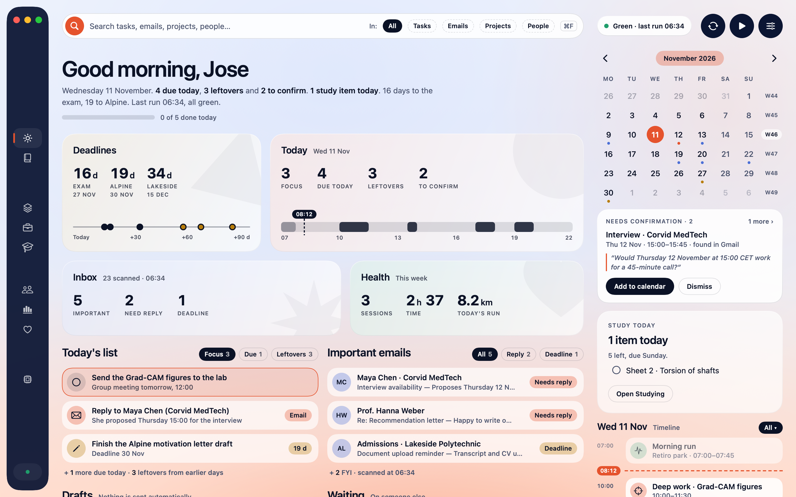
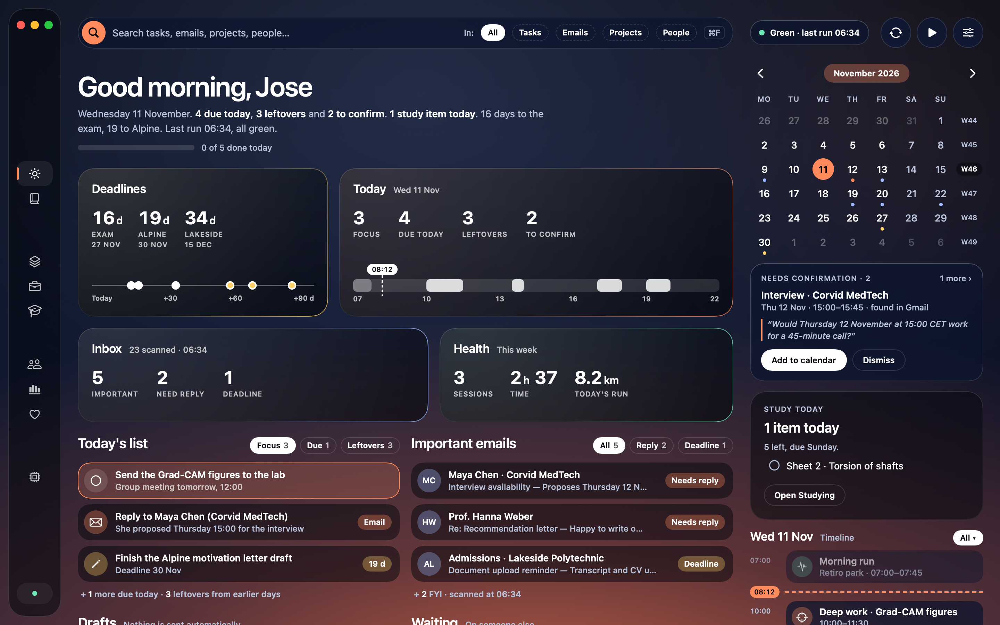

# Desk for Mac

My personal life manager: a native macOS app that answers "what now?" in one glance. Nine tabs: **Today, Studying, Projects, Internship apps, Uni apps, Tutoring, History, Health, System.**




## How it works
Cloud agents read my inbox and calendar every night and write a brief into a private Obsidian vault, which is a git repo. Desk reads those files and my Mac calendar. This repo ships with `demo-vault/`, fully invented data, so the app runs without any of my real information.

## Design choices
These are mine; they are written down in [SPEC.md](SPEC.md) and [DESIGN.md](DESIGN.md).

- **A real native app, not a Claude interface.** SwiftUI, one Swift package, no third-party code.
- **Heavy and physical.** Big type, solid colour blocks, a graphite sidebar over a warm canvas. I took the structure from dashboards I like and swapped their pastels for a darker, earthier palette. No glass, no gradients.
- **Colour marks the category, words carry the meaning.** Every status has a label, never colour alone.
- **Agents read and draft; only I act.** Nothing is sent automatically. A proposed calendar event or a ticked task happens when I click, never before.
- **No server, no credentials.** The app holds no tokens. Its only network use is `git` on the vault and opening links.
- **Untrusted text stays text.** Anything that came from email is drawn as plain text: no Markdown, no links.
- **One writer per file.** The agents own their files, I own mine, and the app writes only mine.
- **WhatsApp is never read.** Desk only opens a prefilled message that I send myself.
- **Zero cost.** Free tools, ad-hoc signature, no developer account.
- **Built to iterate.** Every colour, size and spacing value lives in one file, and each tab is a list of sections I can reorder or hide.

## Built with Claude
I wrote the spec, the design brief and the mockup. Claude Code wrote the Swift in one session, following them, and logged every choice I had left open in [DECISIONS.md](DECISIONS.md). The step-by-step story is in [BUILD_NOTES.md](BUILD_NOTES.md).

## Install it
Open Terminal, paste this line and press Return. No Xcode and no account are needed.

```bash
curl -fsSL https://raw.githubusercontent.com/buendjo777/Life_Desk_App/main/install.sh | bash
```

It downloads the latest release, puts `Desk.app` in Applications and opens it. Needs macOS 14 or newer; works on Apple silicon and Intel.

The first launch is a three-step setup:
1. **Your name**, then *Set up my own desk* (or open a folder you already have, or look around the demo).
2. **Which tabs you want:** Studying, Projects, Internship apps, Uni apps, Tutoring, History, System. Only those appear, and only those get sample files.
3. **Connections, both optional:** your Mac's calendar, and *Fill it in with Claude*, which opens claude.ai with a ready request so Claude asks about your studies, projects and deadlines and gives you the files.

Desk then creates `~/Desk`, plain text you can edit in any editor. Its `CLAUDE.md` tells any AI assistant the file formats.

Make it yours in **Customise** (the sliders button at the top right, or ⌘K): appearance, colours, density, which tabs exist and which sections each one shows. To back the vault up or use it on two Macs, make the folder a private GitHub repository; Desk pulls and pushes it with the `git` already on the Mac. A plain folder works too: then Desk never runs git.

To publish a new version: `scripts/release.sh v1.2`. It builds `Desk.zip` and creates the GitHub release (the GitHub CLI must be signed in once with `gh auth login`).

## Run it from source
Needs macOS 14 or later and Xcode.

```bash
scripts/build-app.sh
```

This installs `Desk.app` to `~/Applications`. It starts in Demo mode. To use a real vault, clone it to `~/jose-brain` or pick the folder in Settings (⌘,).

```bash
swift test
```

My tutoring log lives in one Notes note, "Classes". In Live mode Desk reads it on launch and on ⌘R and writes the vault's `tutoring/` folder, which is gitignored and never leaves the Mac. My default rates, families and the months already paid go in `tutoring/import.json`. The same import from the terminal, without writing:

```bash
open -n -W --stdout "$(tty)" ~/Applications/Desk.app --args --import-classes --dry-run
```

## Status
Demo mode is complete and tested. Live mode is tested against a throwaway repo; I have not yet run it against my real vault and calendar.
